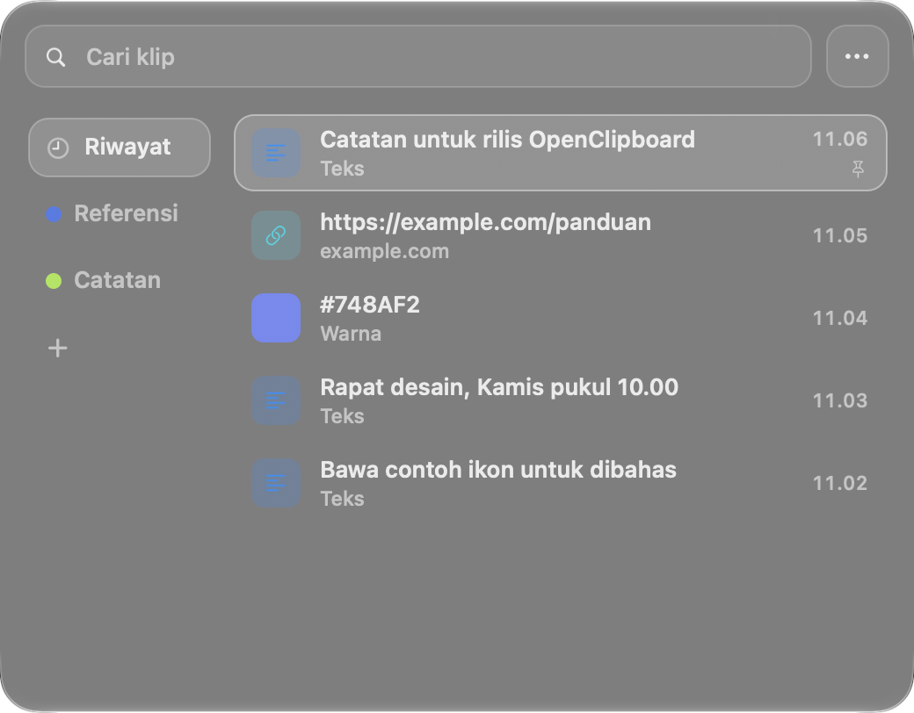
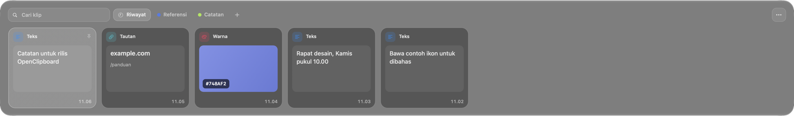
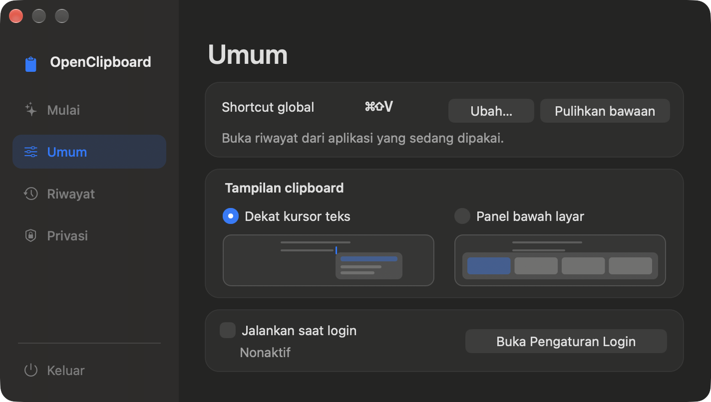

<p align="center">
  
</p>

<h1 align="center">OpenClipboard</h1>

<p align="center">Riwayat clipboard untuk Mac, dibuka dengan ⌘⇧V.</p>

OpenClipboard berguna saat kamu sudah menyalin teks lain dan perlu mengambil salinan sebelumnya. Buka riwayat, ketik sebagian teks yang kamu ingat, lalu pilih klipnya. Tautan, gambar, dan warna juga ikut terekam saat aplikasi berjalan.

## Dua tampilan riwayat

Popup muncul di dekat kursor teks jika izin Accessibility aktif. Daftar klip ada di sebelah kanan, sementara koleksi bisa dipilih dari sisi kiri.

<p align="center">
  
</p>

Kalau lebih suka melihat isi klip sebagai kartu, pilih **Panel bawah layar** di Pengaturan. Kartu ditampilkan berjajar dan bisa digulir ke samping.



## Cara pakai

1. Buka OpenClipboard dari Finder atau Spotlight. Setelah Pengaturan muncul, kamu bisa kembali ke aplikasi tempat kamu bekerja.
2. Salin seperti biasa, lalu tekan <kbd>⌘⇧V</kbd> untuk membuka riwayat. Langsung ketik untuk mencari atau pakai tombol panah untuk berpindah klip.
3. Tekan <kbd>Enter</kbd> untuk memakai klip terpilih. Dengan izin Accessibility, OpenClipboard langsung menempelkannya ke aplikasi asal. Tanpa izin itu, klip disalin dan bisa kamu tempel dengan <kbd>⌘V</kbd>.

| Tombol di riwayat | Aksi |
| --- | --- |
| <kbd>Spasi</kbd> | Buka pratinjau klip |
| <kbd>⌫</kbd> | Hapus klip terpilih |
| <kbd>Esc</kbd> | Tutup riwayat |

Sematkan potongan teks yang sering dipakai, misalnya alamat pengiriman atau jawaban untuk pertanyaan yang berulang. Kalau beberapa klip berkaitan, buat koleksi dari tombol **+**. Klip bisa diseret ke tab koleksi, dan tiap koleksi bisa diberi warna.

## Pengaturan dan privasi

Di tab **Umum**, kamu bisa mengganti pintasan global, memilih tampilan riwayat, dan mengaktifkan **Jalankan saat login**.

<p align="center">
  
</p>

Riwayat disimpan secara lokal di `~/Library/Application Support/OpenClipboard/history.sqlite3`. Dari tab **Riwayat**, kamu bisa mengatur batas jumlah klip biasa dan berapa lama klip disimpan. Klip yang disematkan atau masuk koleksi dikecualikan dari batas riwayat biasa.

Gunakan tab **Privasi** untuk mengecualikan aplikasi tertentu atau mengatur deteksi pola sensitif. Klip yang ditandai sensitif secara manual atau terdeteksi lewat pola hanya disimpan di memori selama OpenClipboard berjalan.

## Build dari source

Skrip build menghasilkan aplikasi untuk Mac Apple Silicon dengan macOS 27.0 atau lebih baru. Siapkan Rust lewat rustup dan Xcode atau Command Line Tools dengan SDK macOS 27. Rustup mengikuti versi yang dipatok di [rust-toolchain.toml](rust-toolchain.toml).

```sh
git clone https://github.com/ryan-prayoga/OpenClipboard.git
cd OpenClipboard
./scripts/build-app.sh
open dist/OpenClipboard.app
```

Untuk menjalankan tes dari direktori repo, pakai `cargo test --locked`. Bagian riwayat dan penyimpanan ditulis dalam Rust, sedangkan antarmuka macOS memakai AppKit.

Panduan izin Accessibility menyertakan kode dari AskForPermission. Pemberitahuan lisensinya ada di [native/AskForPermission/LICENSE](native/AskForPermission/LICENSE).
