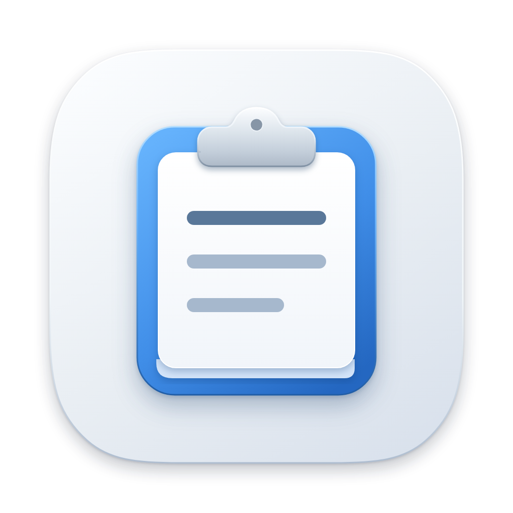

<p align="center">
  
</p>

<h1 align="center">OpenClipboard</h1>

<p align="center">Riwayat clipboard untuk teks, gambar, tautan, dan warna di Mac. Buka dengan ⌘⇧V.</p>

OpenClipboard berguna saat kamu sudah menyalin teks lain dan perlu mengambil salinan sebelumnya. Buka riwayat, ketik sebagian teks yang kamu ingat, lalu pilih klipnya.

## Unduh dan pasang

[Unduh DMG untuk Mac Apple Silicon](https://github.com/ryan-prayoga/OpenClipboard/releases/latest). Dibutuhkan macOS 13 Ventura atau lebih baru.

1. Buka file DMG yang kamu unduh.
2. Seret **OpenClipboard** ke folder **Applications**.
3. Buka OpenClipboard dari Applications atau Spotlight.

Rilis ini belum dinotariskan oleh Apple. Jika macOS memblokir saat pertama dibuka, buka **System Settings → Privacy & Security** dan pilih **Open Anyway**. [Panduan Apple](https://support.apple.com/en-us/102445)

## Dua tampilan riwayat

Di macOS 26 ke atas, Liquid Glass aktif secara bawaan seperti pada screenshot di bawah. Matikan **Gunakan Liquid Glass** di tab **Umum** untuk memakai latar buram. Di macOS 13, 14, dan 15, latar buram otomatis dipakai.

Popup muncul di dekat kursor teks jika izin Accessibility aktif. Pilih koleksi dari sisi kiri. Klip gambar di daftar menampilkan miniatur dan ukuran dalam piksel.

<p align="center">
  
</p>

Kalau lebih suka melihat isi klip sebagai kartu, pilih **Panel bawah layar** di Pengaturan. Kartu ditampilkan berjajar dan bisa digulir ke samping.


## Cara pakai

1. Buka OpenClipboard dari Finder atau Spotlight. Setelah Pengaturan muncul, kamu bisa kembali ke aplikasi tempat kamu bekerja.
2. Salin seperti biasa, lalu tekan <kbd>⌘⇧V</kbd> untuk membuka riwayat. Langsung ketik untuk mencari atau pakai tombol panah untuk berpindah klip.
3. Tekan <kbd>Enter</kbd> untuk memakai klip terpilih. Dengan izin Accessibility, OpenClipboard langsung menempelkannya ke aplikasi asal. Tanpa izin itu, klip disalin dan bisa kamu tempel dengan <kbd>⌘V</kbd>.

| Tombol di riwayat | Aksi |
| --- | --- |
| <kbd>Spasi</kbd> | Buka pratinjau klip |
| <kbd>⌫</kbd> | Hapus klip terpilih |
| <kbd>Esc</kbd> | Tutup riwayat |

Sematkan potongan teks yang sering dipakai, misalnya alamat pengiriman atau jawaban untuk pertanyaan yang berulang. Kalau beberapa klip berkaitan, buat koleksi dari tombol **+**. Klip bisa diseret ke tab koleksi, dan tiap koleksi bisa diberi warna.

## Salin dan tempel gambar

Salin gambar dari aplikasi seperti Preview, atau ambil screenshot ke clipboard dengan <kbd>⌃⇧⌘4</kbd>. Buka OpenClipboard dengan <kbd>⌘⇧V</kbd>, pilih klip berlabel **Gambar**, lalu tekan <kbd>Spasi</kbd> untuk melihat pratinjau atau <kbd>Enter</kbd> untuk memakainya kembali.

OpenClipboard menyimpan gambar yang tersedia di clipboard sebagai PNG atau TIFF, dengan batas 25 MiB per klip gambar.

## Pengaturan dan privasi

Di tab **Umum**, kamu bisa mengganti pintasan global, memilih tampilan riwayat, mengatur Liquid Glass, dan mengaktifkan **Jalankan saat login**.

<p align="center">
  
</p>

Riwayat disimpan secara lokal di `~/Library/Application Support/OpenClipboard/history.sqlite3`. Dari tab **Riwayat**, kamu bisa mengatur durasi simpan klip biasa. Kuota 256 MiB mencakup isi klip dan thumbnail lokal. Saat kuota penuh, OpenClipboard menghapus klip biasa yang paling lama disalin untuk menyediakan ruang. Klip sematan dan klip di koleksi dilindungi dari penghapusan otomatis.

Gunakan tab **Privasi** untuk mengecualikan aplikasi tertentu dari riwayat clipboard.

## Build dari source

Skrip build menghasilkan aplikasi untuk Mac Apple Silicon dengan macOS 13 Ventura atau lebih baru. Siapkan Rust lewat rustup dan Xcode atau Command Line Tools dengan SDK macOS 26 atau lebih baru. Rustup mengikuti versi yang dipatok di [rust-toolchain.toml](rust-toolchain.toml).

```sh
git clone https://github.com/ryan-prayoga/OpenClipboard.git
cd OpenClipboard
./scripts/build-app.sh
open dist/OpenClipboard.app
```

Untuk menjalankan tes dari direktori repo, pakai `cargo test --locked`. Bagian riwayat dan penyimpanan ditulis dalam Rust, sedangkan antarmuka macOS memakai AppKit.

Panduan izin Accessibility menyertakan kode dari AskForPermission. Pemberitahuan lisensinya ada di [native/AskForPermission/LICENSE](native/AskForPermission/LICENSE).

## Menerbitkan rilis

Samakan versi di `Cargo.toml`, entri `openclipboard` di `Cargo.lock`, dan `CFBundleShortVersionString` di `native/Info.plist`. Naikkan juga `CFBundleVersion` dan tulis perubahan yang dirasakan pengguna di `docs/releases/v<versi>.md`. Workflow memakai isi file itu sebagai catatan rilis. Setelah perubahan masuk ke `main`, buat dan push tag yang sesuai. Contoh untuk versi 0.1.5:

```sh
git tag v0.1.5
git push origin v0.1.5
```

GitHub Actions menjalankan tes, membuat DMG dan checksum SHA-256, lalu menerbitkan keduanya di GitHub Releases. Untuk mencoba build tanpa menerbitkan rilis, jalankan workflow **Release macOS** secara manual dari tab **Actions**.

### Pembaruan dari aplikasi

Untuk mengaktifkan **Periksa pembaruan** → **Pasang pembaruan** di rilis:

1. Unduh Sparkle dengan `sh scripts/fetch-sparkle.sh /path/ke/sparkle`. Jalankan
   `bin/generate_keys --account openclipboard` dari direktori hasil unduhan.
2. Simpan public key sebagai GitHub Actions variable
   `OPENCLIPBOARD_UPDATE_PUBLIC_KEY`. Ekspor private key dengan
   `bin/generate_keys --account openclipboard -x /path/ke/private-key` dan simpan
   sebagai Actions secret `OPENCLIPBOARD_UPDATE_PRIVATE_KEY`.
3. Pertahankan pasangan kunci yang sama untuk rilis berikutnya. Workflow
   menandatangani DMG dan appcast setiap kali tag rilis dipublikasikan.

Rilis publik memerlukan sertifikat **Developer ID Application** dari Apple Developer
Team yang sama untuk mempertahankan identitas aplikasi antarversi. Konfigurasikan
Actions secrets `OPENCLIPBOARD_DEVELOPER_ID_P12` (berkas PKCS#12 berisi sertifikat
dan kunci privat, dikodekan Base64) dan `OPENCLIPBOARD_DEVELOPER_ID_PASSWORD`
(kata sandi ekspor). Atur Actions variable `OPENCLIPBOARD_DEVELOPER_TEAM_ID` ke
Team ID Apple. Untuk notarization, siapkan profil `notarytool` di runner dan atur
`OPENCLIPBOARD_NOTARY_PROFILE`. Pengguna yang beralih dari build ad hoc mungkin
perlu memberi izin Accessibility sekali setelah memasang build Developer ID pertama.

Untuk Mac pengembangan dengan identitas **OpenClipboard Local Code Signing** di
Rantai Kunci, jalankan `./scripts/install-local.sh` dari checkout versi yang ingin
dipasang. Skrip menggunakan sertifikat lokal yang sama untuk setiap pembaruan.
Tombol **Periksa pembaruan** tetap menampilkan versi terbaru dan tautan rilis.
